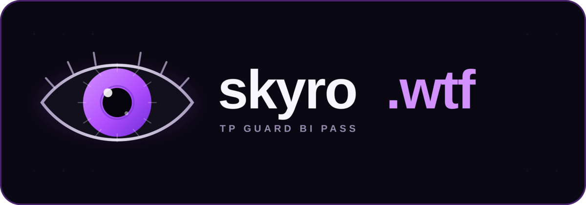

# skyro.wtf — TP Guard BI Pass



**Credits: f9nkz on Discord for all testing.**

Windows GUI and executor Lua helper for current-server deep links. Power starts **ON**. Saved logs are never loaded back in.

Tutorial video: [media/tpguard-tutorial.mp4](https://github.com/skyr0cc/tpguard-bypass/raw/main/media/tpguard-tutorial.mp4).

## Quick start

1. Grab the Windows zip from [Releases](https://github.com/skyr0cc/tpguard-bypass/releases/latest) and run `skyro.wtf.exe`.
2. Power is already **ON** in the top bar. Set delay and retry if needed.
3. Press `REJOIN` to send the current server deep link. Power turns itself off after the send.
4. Press `GET LUA SCRIPT`. It writes `lua\skyro_wtf.lua` beside the exe.
5. Put `skyro_wtf.lua` in your executor's `auto execute` folder.

## What it does

- GUI reads the live `game.JobId` and builds `roblox://experiences/start?placeId=<id>&gameInstanceId=<job>`.
- Generated Lua uses executor request functions only: `syn.request`, `http.request`, `http_request`, `fluxus.request`, `request`.
- Generated Lua listens to live `request`, `writefile`, `appendfile`, and `setclipboard` calls. No function hooks, no read-only table writes.
- No `readfile`, no `listfiles`, no startup sweep, no replay of saved logs. Files are outputs only.
- Both `REJOIN` and `RECONNECT` force the current server through the same deep link path.
- Auto-joiner scripts that expose `__aj_boot` are stopped before a deep link via `set_panel_live(false)`, `stop`, and `shutdown`.
- GUI is a 600×400 layered Win32 window with a DX11/ImGui renderer and smooth wheel scrolling.

## Build

MSVC, from a Developer Command Prompt:

```bat
build.bat
```

MinGW cross-build on Linux:

```bash
make
# or
./build.sh
```

CMake:

```bash
cmake -S . -B out -A x64
cmake --build out --config Release
```

Each build copies `assets/` next to the executable. The logo is for this README; the GUI backdrop still comes from `assets\login.jpg`.

## Controls

| Control | Behaviour |
| --- | --- |
| Power | Starts **ON**. Toggles the GUI service state. Clicking it cancels an armed auto-stop. |
| TOP | Toggles `SetWindowPos` between `HWND_TOPMOST` and `HWND_NOTOPMOST`. |
| Delay Between Each Join | Defaults to `0.15` seconds. Clamps to `0.01..60.00`. |
| Retry | Defaults to `10`. Clamps to `1..1000`. |
| REJOIN | Full-width accent-pulse button. Sends the live-server deep link, then powers off after `1.2` s. |
| GET LUA SCRIPT | Writes `lua\skyro_wtf.lua` beside the exe with the current delay and retry values. |
| Scroll | Wheel over the content eases the scroll target. The right rail can be clicked or dragged. |

`Esc` closes the window. Drag the top bar to move it.

## Generated Lua

`src/tp_guard_lua.h` is the single source for the generated script. The panel only substitutes delay and retry.

- Job ids come from live tapped payloads and `game.JobId` only.
- `__aj_boot` and `odyssey_api` are scanned at load, on taps, before deep links, and every 2 seconds for late ODY loads.
- `RESCAN ODY` in the Lua panel forces an immediate ODY API rescan.
- Joins are blocked while `AUTO ON` is off.
- The teleport queue is filtered at load: ODY queue scripts are dropped by source signature.
- The teleport queue is cleared at load and again before every deep link, then only a tagged TP Guard marker is queued.
- The marker initializes ODY globals before `AJS stop/shutdown`, so the no-queue teleport guard does not fire.
- Console, warn, rconsole, messagebox, and Roblox `LogService.MessageOut` output is tapped.
- Plain-text job ids in logs are parsed from UUIDs, `jobId:`, `jobId=`, and `gameInstanceId=`, then driven through the same deep-link path.
- Every deep link logs the armed ODY globals and queue-filter state before the join.
- Deep links are parsed from `gameInstanceId` and `placeId` in live data.
- Captured jobs appear in a small in-game panel with their own `JOIN` button.
- `AUTO ON`, `RESCAN ODY`, `REJOIN`, `RECONNECT`, and `CLEAR` sit in the Lua panel.
- Outputs are written to `tp_guard/server.json` and `tp_guard/rejoin.txt`. Nothing is read back.
- If the executor refuses the scheme, fallbacks run through `ExperienceService`, `TeleportService`, web start, clipboard, and `GuiService`.

## Repo layout

```text
.
├── assets/
│   ├── login.jpg                    # GUI backdrop
│   ├── skyro-logo.svg               # README logo, vector
│   └── skyro-logo.png               # README logo, raster
├── media/
│   ├── tpguard-tutorial.mp4         # tutorial video
│   └── tpguard-tutorial-thumb.png   # tutorial thumbnail
├── src/
│   ├── skyro_wtf.cpp                # Win32 shell, DX11 renderer, ImGui UI
│   └── tp_guard_lua.h               # generated Lua source
├── tools/
│   ├── tpguard.sh                   # original shell deep-link example
│   └── tpguard.bat                  # original batch deep-link example
├── vendor/imgui/                    # Dear ImGui 1.90.9 + Win32/DX11 backends
├── .gitignore
├── CMakeLists.txt
├── Makefile
├── build.bat
└── build.sh
```

## Runtime

The executable is statically linked. No runtime DLLs ship with it. Imports are `KERNEL32.dll`, `USER32.dll`, `GDI32.dll`, `gdiplus.dll`, `msvcrt.dll`, `d3d11.dll`, `dxgi.dll`, `D3DCOMPILER_47.dll`, `dwmapi.dll`. MSVC uses `/MT`; MinGW uses `-static -static-libgcc -static-libstdc++`.
