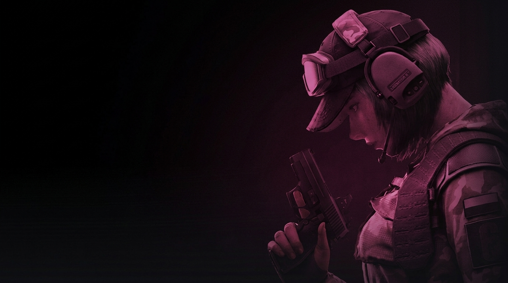

# skyro.wtf — Deep Link Server Joiner

Compact Dear ImGui launcher for Roblox place `109983668079237`. Purple and white, DX11-smooth, sectioned into Control, Target, Live, and Auto Execute Script. It starts a local job-ID listener, fires the `roblox://experiences/start` deep link, and generates hook-free auto-execute Lua that feeds job IDs back into the launcher.



## Layout

```
.
├── assets/
│   └── login.jpg                     # window background, loaded at runtime
├── build/                            # generated binaries, ignored by git
│   ├── skyro_wtf.exe
│   └── assets/login.jpg
├── src/
│   └── skyro_wtf.cpp                 # ImGui UI, listener, worker, Lua generator
├── tools/
│   ├── tpguard.sh                    # original shell proof of concept
│   └── tpguard.bat                   # original batch proof of concept
├── vendor/
│   └── imgui/                        # Dear ImGui 1.90.9 + Win32/DX11 backends
│       ├── LICENSE.txt
│       ├── imconfig.h
│       ├── imgui.cpp
│       ├── imgui.h
│       ├── imgui_draw.cpp
│       ├── imgui_internal.h
│       ├── imgui_tables.cpp
│       ├── imgui_widgets.cpp
│       ├── imstb_rectpack.h
│       ├── imstb_textedit.h
│       ├── imstb_truetype.h
│       └── backends/
│           ├── imgui_impl_dx11.cpp
│           ├── imgui_impl_dx11.h
│           ├── imgui_impl_win32.cpp
│           └── imgui_impl_win32.h
├── .gitignore
├── CMakeLists.txt
├── Makefile
├── build.bat                         # MSVC one-shot build
└── build.sh                          # MinGW cross-build wrapper
```

## Build

MSVC, from a Developer Command Prompt:

```bat
build.bat
```

MinGW cross-build on Linux:

```bash
make
# or
./build.sh
```

CMake, any generator:

```bash
cmake -S . -B out -A x64
cmake --build out --config Release
```

Each build copies `assets/` next to the executable. The exe resolves `assets\login.jpg` from its own module path, so keep the folder beside the binary when moving it.

## Interface

| Section | Control | Behaviour |
| --- | --- | --- |
| Control | `Interceptor` | Gates job intake and deep-link retries. Off means captured jobs are dropped. |
| Control | `START SERVER` | Binds `127.0.0.1:<port>`, starts the worker, fires `roblox://experiences/start?placeId=<place>`. Becomes `STOP SERVER`. |
| Target | `Place ID` | Target place, default `109983668079237`. |
| Target | `Port` | Local listener port, default `6969`. Read on server start. |
| Target | `Retries` | Deep-link attempts per captured job, default `10`. |
| Target | `Delay (ms)` | Milliseconds between attempts, default `1500`. |
| Live | counters | Captured jobs, deep-link attempts, last job ID, current status. |
| Auto Execute Script | `COPY SCRIPT` | Copies the generated Lua to the clipboard. |
| Auto Execute Script | text box | Read-only script, regenerates on every field change. |

The window is 520x590 with compact 15 px Segoe UI text and 13 px Consolas for the script. Fonts resolve through `GetWindowsDirectoryW`, so no font files ship with the build.

## How it works

1. `START SERVER` calls `ShellExecuteW` with `roblox://experiences/start?placeId=<place>`, the same deep link the original `tpguard` proof of concept used. A Winsock listener then binds `127.0.0.1:<port>` on a background thread.
2. The generated Lua is pasted into auto execute. It listens to `DescendantAdded` on `ReplicatedStorage`, `ReplicatedFirst`, and `Players`, plus `PlayerAdded` attributes. A throttled poll every 0.5 seconds scans `game.JobId`, string values, text objects, and attributes for UUID-shaped job IDs. There are no function hooks and no metatable hooks anywhere in the script.
3. Captured job IDs are deduplicated in a 128-entry cache, then POSTed as JSON to `http://127.0.0.1:<port>/job`. Executor HTTP fallbacks are tried in order: `syn.request`, `http_request`, `request`.
4. The listener parses `jobId` out of the request body, returns `200 {"ok":true}`, and pushes the ID to a bounded work queue. If the toggle is off, the ID is discarded and the status text says so.
5. The worker builds `roblox://experiences/start?placeId=<place>&gameInstanceId=<jobId>` and fires it through `ShellExecuteW`. It repeats up to `RETRIES` times with `DELAY (MS)` between attempts. The Lua side runs the same retry count through `TeleportToPlaceInstance` and exits early once `game.JobId` matches the captured ID.
6. ImGui renders every frame through DX11. Status, counters, and the last job ID are read from mutex-protected state during `DrawInterface`. Shutdown stops the producer, wakes and joins the worker, closes the listener, shuts down ImGui and DX11, then releases GDI+.

## Lua shape

Generated script constants:

```lua
local PLACE_ID = 109983668079237
local PORT = 6969
local RETRIES = 10
local DELAY = 1.5000
local ENDPOINT = "http://127.0.0.1:" .. PORT .. "/job"
```

Observation coverage:

- `DescendantAdded` connections on three services, stored in a connection list.
- `PlayerAdded` attribute scan.
- Poll loop over `game.JobId` and bounded descendant scans: 400 for `ReplicatedStorage`, 200 each for `ReplicatedFirst` and `Players`.
- Every scan is wrapped in `pcall`, so auto execute keeps running if an instance or property is inaccessible.
- No varargs in the generated script, which keeps it portable across executor Lua variants that lack `table.pack`.

## Runtime dependencies

The executable is linked statically. No `libgcc_s_seh-1.dll`, `libstdc++-6.dll`, or `libwinpthread-1.dll` ships with it. Imports are Windows system DLLs only: `KERNEL32.dll`, `USER32.dll`, `GDI32.dll`, `SHELL32.dll`, `WS2_32.dll`, `gdiplus.dll`, `msvcrt.dll`, `d3d11.dll`, `dxgi.dll`, `D3DCOMPILER_47.dll`, `dwmapi.dll`. Copy `build/skyro_wtf.exe` and `build/assets/` to a machine and it runs without a MinGW runtime install.

MSVC builds use `/MT`; MinGW builds use `-static -static-libgcc -static-libstdc++`.

## Notes

- Port changes require `STOP SERVER` then `START SERVER`; the listener reads the port once at bind time.
- Retries and delay are clamped: retries `1..1000`, delay `50..60000` ms, port `1..65535`.
- If the Lua runs on a different machine than the exe, replace `127.0.0.1` in `ENDPOINT` with the host running the listener.
- The background image is loaded through GDI+, converted to a DX11 shader resource, and tinted purple in ImGui's background draw list. If `assets/login.jpg` is missing, the window falls back to a solid purple fill.
- Dear ImGui 1.90.9 is vendored under `vendor/imgui` with its MIT license; no external package manager is needed.
